# Mau ket qua kiem thu Mininet

Ten nguoi thuc hien: ____________________<br>
Ngay kiem thu: ____________________<br>
Ubuntu: ____________________

## Cach su dung

- Chay cac muc 1-4 trong terminal Ubuntu, tai thu muc chua `Network`.
- Muc 3 chi chay neu co file Excel quy hoach IP. Neu khong co, ghi `Khong ap dung`.
- De chay muc 5-10, don Mininet mot lan bang `sudo mn -c`, sau do chay `sudo python3 topology.py`. Nhap cac lenh tuong ung tai dau nhac `mininet>`.
- Chi danh dau Dat khi ket qua thuc te dung voi mong doi. Neu can bo sung minh chung, chen anh vao muc tuong ung.
- Khong chay `mn -c` khi topology dang hoat dong.

## 1. Phien ban moi truong

**Lenh (terminal Ubuntu):**

```bash
lsb_release -a
mn --version
ovs-vsctl --version
iperf3 --version
```

**Mong doi:** Hien thong tin Ubuntu, Mininet, Open vSwitch va iperf3.<br>
**Ket qua:** Da kiem tra. Ubuntu 26.04.1 LTS; Mininet 2.3.0; Open vSwitch 3.7.1; iperf3 3.20.<br>
**Anh minh chung:** Anh 1 da duoc chen ben duoi. Luu y: README du an ghi Ubuntu 22.04 LTS la phien ban khuyen nghi.

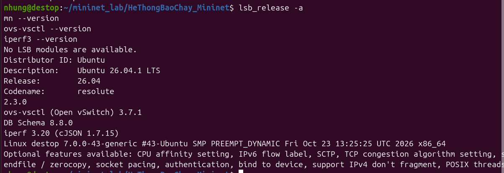

## 2. Kiem tra Mininet va Open vSwitch

**Lenh (terminal Ubuntu):**

```bash
sudo python3 topology.py --check-env
```

**Mong doi:** Hien `Environment OK` va khong bao thieu tien ich/module.<br>
**Ket qua:** Dat. Lenh `--check-env` xac nhan da co Mininet, Open vSwitch va `ip`.<br>
**Anh minh chung:** Anh 2 da duoc chen ben duoi.

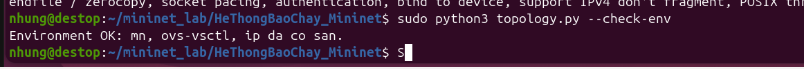

## 3. Doi chieu quy hoach IP voi Excel (neu co file)

**Lenh (terminal Ubuntu):**

```bash
python3 topology.py --check-plan ../docs/quy_hoach_IP_VLAN_v2.xlsx,
```

Thay ten file neu file Excel co ten/duong dan khac.

**Mong doi:** Doi chieu thanh cong, khong co IP sai lech. Neu khong co file Excel, ghi `Khong ap dung`.<br>
**Ket qua:** Khong ap dung theo yeu cau; khong doi chieu Excel.<br>
**Anh minh chung:** Khong co.

## 4. Bo kiem tra tu dong cua topology (anh quan trong nhat)

**Lenh (terminal Ubuntu):**

```bash
sudo python3 topology.py --test --no-cli 2>&1 | tee ket_qua_test.txt
```

**Mong doi:** Cac phep thu trong bang hien `DAT` va ket luan hien `TAT CA DAT`. Neu co muc `KHONG DAT`, giu nguyen ket qua de xu ly, khong ghi la Dat.<br>
**Ket qua:** Dat. Cac phep thu hien trong anh co 0% mat goi; 30 host cam bien/camera ping duoc server; 31 cong access dung tag va trunk `s1-gw` co VLAN 10, 20, 30; ket luan `TAT CA DAT`.<br>
**Anh minh chung:** Anh 4 da duoc chen ben duoi.

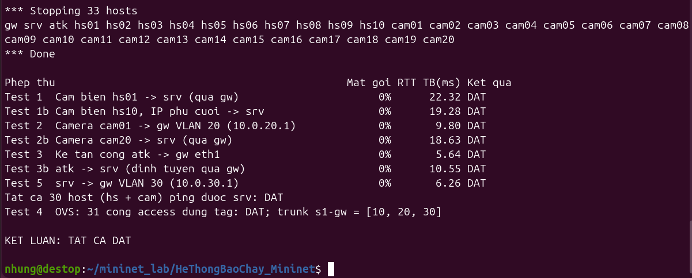

## Chuan bi cho muc 5-10

Sau khi muc 4 da ket thuc, tai terminal chay:

```bash
sudo mn -c
sudo python3 topology.py
```

Khi hien `mininet>`, chay cac lenh o muc 5-10. Muc 5 la lenh Mininet; cac muc co tien to `gw`, `hs01`, `sh` la lenh chay trong node/host tuong ung.

## 5. Kiem tra danh sach node va lien ket

**Lenh (tai `mininet>`):**

```text
nodes
links
```

**Mong doi:** Co 34 node va 33 lien ket theo mo hinh: switch, gateway, server, host tan cong, 10 host cam bien va 20 host camera.<br>
**Ket qua:** Dat. Danh sach co 34 node; cac lien ket hien thi trang thai `(OK OK)`.<br>
**Anh minh chung:** Anh 5a va 5b da duoc chen ben duoi.

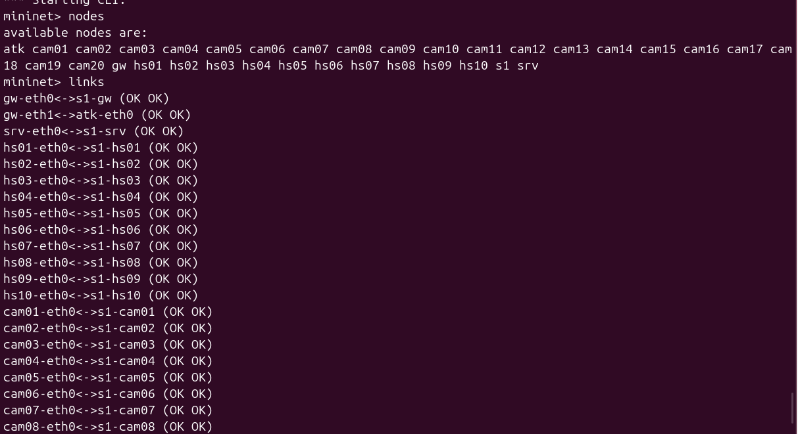

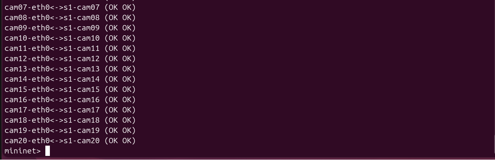

## 6. Kiem tra interface, route va IP forwarding cua gateway

**Lenh (tai `mininet>`):**

```text
gw ip -br addr
gw ip route
gw sysctl net.ipv4.ip_forward
```

**Mong doi:** Gateway co `gw-eth0.10`, `gw-eth0.20`, `gw-eth0.30`, `gw-eth1`; IP forwarding bang `1`.<br>
**Ket qua:** Dat. Cac giao dien va IP gateway hien thi dung; bang route co cac mang VLAN 10/20/30 va mang ngoai; `net.ipv4.ip_forward` bang `1`.<br>
**Anh minh chung:** Anh 6a va 6b da duoc chen ben duoi.

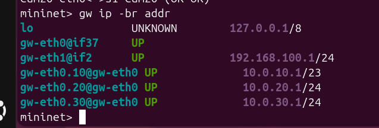

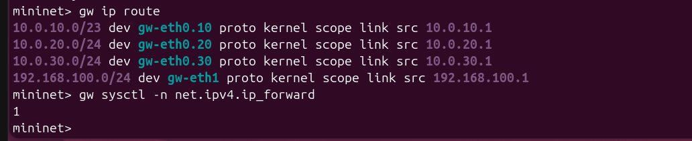

## 7. Dem dia chi IPv4 tren mot host cam bien

**Lenh (tai `mininet>`):**

```text
hs01 ip -4 addr show hs01-eth0 | grep -c inet
```

**Mong doi:** Hien so `30` (1 IP chinh va 29 IP phu tren `hs01-eth0`).<br>
**Ket qua:** Dat. `hs01-eth0` co 30 dia chi IPv4.<br>
**Anh minh chung:** Anh 7 da duoc chen ben duoi.

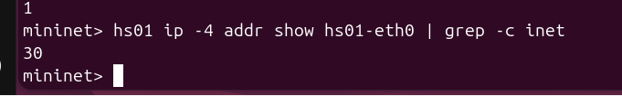

## 8. Kiem tra VLAN access va trunk tren OVS

**Lenh (tai `mininet>`):**

```text
sh ovs-vsctl --columns=name,tag,trunks list Port | grep -E 's1-hs01|s1-cam01|s1-srv|s1-gw'
```

**Mong doi:** Cac cong dai dien `s1-hs01`, `s1-cam01`, `s1-srv` co tag 10, 20, 30; `s1-gw` trunk VLAN 10, 20, 30. Bo kiem tra tu dong o muc 4 da kiem tra tat ca cong access.<br>
**Ket qua:** Dat. Anh hien tag 10 tren cong cam bien, tag 20 tren cong camera, tag 30 tren server va trunk `s1-gw` mang VLAN 10, 20, 30.<br>
**Anh minh chung:** Anh 8a va 8b da duoc chen ben duoi.

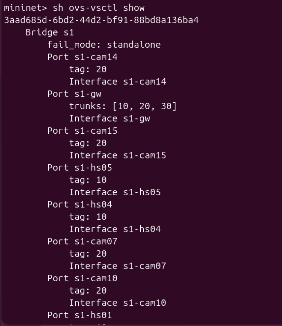

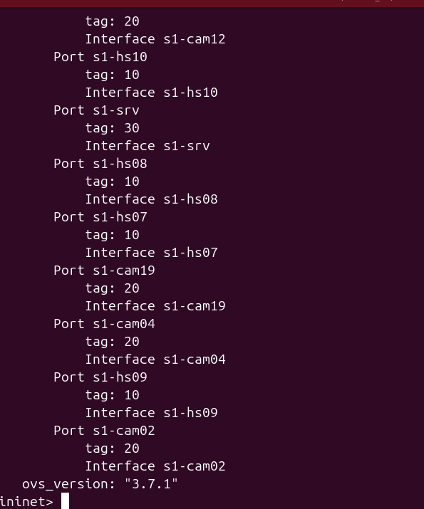

## 9. Quan sat goi tin co VLAN tag (tuy chon nang cao)

**Lenh (tai `mininet>`):**

```text
gw timeout 5 tcpdump -i gw-eth0 -e -n vlan -c 10 > /tmp/vlan.txt 2>&1 &
hs01 ping -c 3 srv
sh cat /tmp/vlan.txt
```

**Mong doi:** Ping hoan tat va tcpdump co the hien goi tin tren trunk cung thong tin VLAN tag. Can co `tcpdump` tren Ubuntu.<br>
**Ket qua:** Dat. Ping mat 0% goi; tcpdump bat duoc goi VLAN 10 va VLAN 30, 8 goi, 0 goi bi kernel drop.<br>
**Anh minh chung:** Anh 9a va 9b da duoc chen ben duoi.

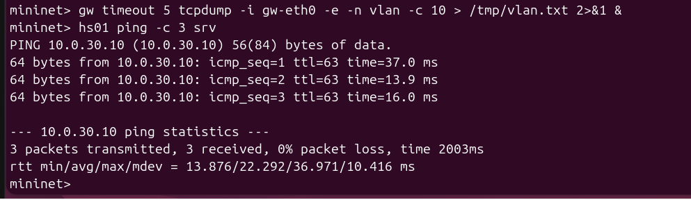

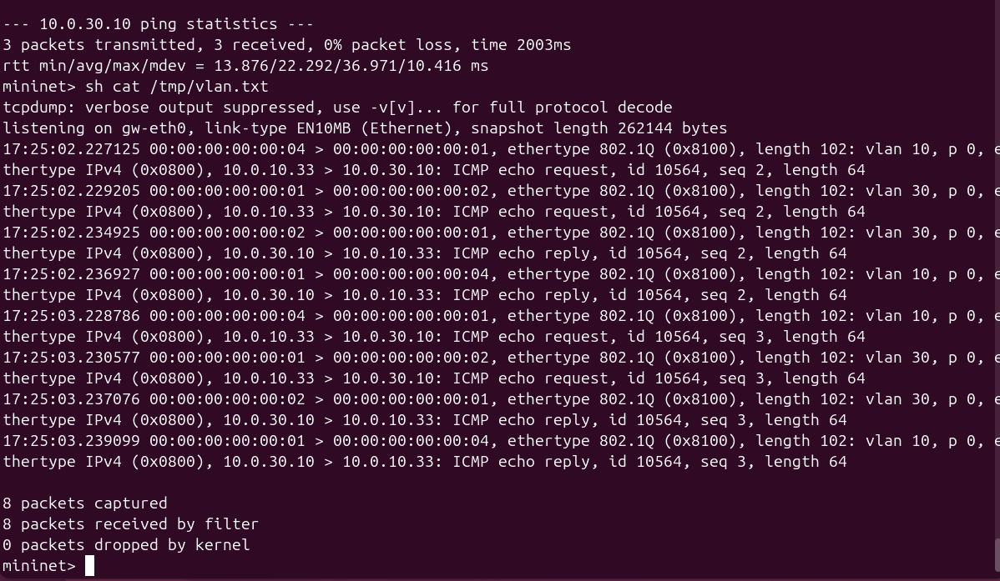

## 10. Kiem tra hang doi/qdisc tren lien ket gateway

**Lenh (tai `mininet>`):**

```text
gw tc qdisc show dev gw-eth0
```

**Mong doi:** Ghi lai qdisc hien co tren interface; day la bang chung cau hinh hang doi/lien ket, khong tu no chung minh thong luong thuc te.<br>
**Ket qua:** Dat. Interface `gw-eth0` co qdisc `htb` va `netem` voi do tre `1ms`.<br>
**Anh minh chung:** Anh 10 da duoc chen ben duoi.

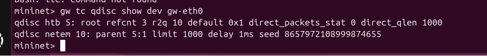

## Tong ket

- So muc Dat: 9 / 10
- So muc Khong dat: 0
- So muc Khong ap dung: 1 (muc 3)
- Ghi chu: Ubuntu 26.04.1 LTS; README du an khuyen nghi Ubuntu 22.04 LTS.

Thoat Mininet bang lenh `exit`.
